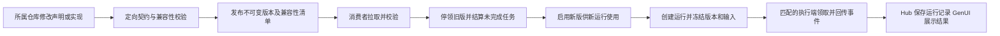

# GenUI 与工作流维护决议及优化清单

日期：2026-10-23。状态：Q1–Q6 及 Q4 补充均已确认；单用户 Hub 控制面阶段已实现并定向验证，跨库消费者改造与主机验收另行记录。源码交付身份以 Git 提交及远端 SHA 核对为准。

## 单用户阶段交付

维护者明确只有本人使用，接受破坏性维护。因此本阶段采用一个 Git 声明目录、每个流程一个当前执行版本；不提供旧命令代理、旧数据库迁移或多版本兼容矩阵。历史定义和输入保持不可变，是为了追溯，不承担旧实现持续可执行的承诺。

本轮实现范围为 Hub 的 learning_workflows、统一 agent 入口、workflow fixture 菜单、运行数据忽略规则及相关文档。保持既有 workspace/sync-plan.json 改动原样，不修改 Forge、模型桥接或工程迁移/发布 Graph，不连接用户实际运行库、不重启服务、不安装系统调度。

- 声明移至明确的 catalog.json；能力引用、步骤、输入/输出边界与内容 SHA256 一起校验。输入规则不再重复写死在 Python。
- 启用目录在一个写事务中更新；旧未完成运行结算为 cancelled 并记录“升级终止”，撤销租约和注册，迟到回报拒绝。同目录重启不重复中断；非法变更整体回滚。
- 新建采用当前版本，重试创建关联旧运行的新实例并选择当前版本；请求重传保持幂等，不等同于再次重试。
- 状态格式 2 使用持久目录，旧库明确拒绝且不修改。提供只读 inspect、30 天终态清理、固定槽位 7 份一致性备份和恢复前清理；恢复后不重放未完成任务。
- 服务启动维护一次，运行时每分钟检查、每日到期备份。离线维护由 maintain 命令执行；系统每日调度尚未安装。/v1/status 暴露维护失败。

本地验证：workflow fixture 22 项通过，包含真实 CLI 子进程启停、随机回环 HTTP、单实例写锁和重连后跨执行端身份重试；既有 maintenance fixture 49 项、规则继承 fixture 11 项通过。根指南与本目录 AGENTS.md 已明确单用户约束、动作效果、数据边界及验收口径；Forge workflow 观察配置仅声明明确候选。测试均使用临时状态，不等同于实际 Forge、跨设备、后台执行或离线调度验收。

## 目的与观察边界

目标是确定可复用声明、客户端实现、运行记录及模型会话分别由谁维护，以及更新如何抵达消费者。远端 Git 协作、版本分发服务和常驻运行服务是不同职责，不能统称为“远端维护”。

初次讨论的 Hub 观察 HEAD 为 `535c907d63fdd077d5a0bf5c576e50cedddc37b1`；Forge 为 `b501f210f275a5a40197e3be2fd38b5d808a782b`。随后决议文档以 `a41296c` 推送。初次观察不能替代本轮源码交付身份，也不能证明业务工作流已在主机启用。

调查按注册表定位，只读取明确候选；Hub 子调查读取 10 个内容文件，Forge 子调查读取 16 个。未读取运行数据库或真实凭据，未运行服务、构建或平台验收。这里只记录已观察实现和建议，不声称全项目覆盖。

## 已核实的两条链路

| 链路 | 当前职责 | 证据 |
| --- | --- | --- |
| GenUI 实验台 | 模型在受限组件目录内组织界面，Flutter 执行参数更新和布局观测；另有固定回放 | [Forge 规划](/Users/forest/code/langGraph/flutter_forge/docs/GENUI_WORKBENCH_PLAN.md:9) |
| 工作流实验台 | Hub 管理当前教学流程、输入冻结、运行与事件；Forge 执行，GenUI 根据 schema 和结果展示 | [Forge 基建说明](/Users/forest/code/langGraph/flutter_forge/docs/WORKFLOW_ECOSYSTEM_FOUNDATION.md:17)、[Hub 声明](/Users/forest/code/agent-hub/src/agent_hub/learning_workflows/catalog.json) |

当前第二条链路尚未实现模型生成并发布工作流。模型输出界面或动作，也不能直接成为工程执行授权。

Hub 服务固定绑定 `127.0.0.1`，没有在线编辑或发布流程的 API。本轮将原 Python 常量迁至 JSON 声明，在启动时校验并启用；默认状态也从临时示例路径改为持久目录。SQLite 保存当前目录及权威运行历史，不是可丢弃缓存。[服务入口](/Users/forest/code/agent-hub/src/agent_hub/learning_workflows/cli.py)、[存储](/Users/forest/code/agent-hub/src/agent_hub/learning_workflows/store.py)、[使用说明](/Users/forest/code/agent-hub/docs/learning-workflows.md)。

Forge 当前只接受 `articles.explore` v1，执行依赖页面存活。跨设备连接、关闭页面后继续执行和共享历史均不能从当前构建或 HTTP 接口存在推导出来。[消费边界](/Users/forest/code/langGraph/flutter_forge/apps/flutter_forge/lib/modules/ui/workflow_workbench/workflow_session.dart:48)。

## 信息所有权决议

已确认 Git 评审发布、本机运行、最新版重试和有限数据保留。接受破坏性重构；升级时停止旧版本领取，将未完成旧任务明确结算为“升级终止”并保留历史，再切换新版，不维护旧执行实现。

| 信息 | 权威位置 | 本地/远端更新方式 |
| --- | --- | --- |
| 流程定义、输入输出 schema、能力声明 | Hub 所属 Git 仓库；正式版本经评审发布 | 本地修改和测试，远端 Git 协作；新增不可变版本 |
| 组件目录、builder、动作映射、executor、模型适配器、SDK pin | Forge 所属 Git 仓库 | 随客户端或执行端版本交付；Forge 生成契约仍由 Forge 生成器维护 |
| 提示策略、固定回放、可复用模板 | 实际消费者所属 Git 仓库 | 与组件/协议版本一起校验；模型输出经整理、审查后才提升为模板 |
| 已发布版本及兼容性清单 | 初期采用 Git/release 制品，后续按需要引入分发服务 | 消费者拉取并校验固定版本；服务端新版本存在不等于客户端立即可用 |
| 输入、结果、错误、事件、运行冻结快照 | 本机 Hub 持久数据目录 | 运行记录默认保留 30 天；每日一致性备份保留最近 7 份；允许配置 |
| 模型生成的 surface、消息、实验参数 | 默认当前会话，不自动落盘 | 脱敏运行证据显式保存；不自动全部回写 Git |
| token、个人 endpoint、登录状态 | 当前进程或明确选择的凭据存储 | 不进入源码、下载模板或索引；模型请求的数据传输边界单独说明 |

组件目录含开发者提供的 schema 与 Flutter builder，因此远端下发数据只能使用已有能力；新增原生组件或执行能力仍需对应客户端交付。官方文档也将 Catalog 与运行时 DataModel/消息分开，且 SDK 仍处 alpha；本次本地锁定 `genui 0.10.4`、`a2ui_core 0.1.1`，不能按最新文档直接推导旧消费者兼容性。[官方概念说明](https://docs.flutter.dev/ai/genui/components)、[本地依赖](/Users/forest/code/langGraph/flutter_forge/apps/flutter_forge/pubspec.yaml:54)。

## 更新流程与实施要求

1. 在所有者仓库修改。Hub 不复制 Forge builder/executor，也不直接修改 Forge 生成契约。先提交各自精确范围，避免把当前 dirty 工作区描述为已发布版本。
2. 用 fixture 校验 schema、动作与能力映射、非法输入、事件顺序以及消费者支持范围。跨仓库联调绑定真实消费版本；本地测试与跨设备/后台执行验收分开。
3. 发布不可变版本。建议清单绑定 workflow/schema/catalog/protocol 版本、所需 capability、executor/客户端源码或制品身份和内容摘要。不能只校验能力名称就声称实现一致。
4. 消费者先校验兼容性，再启用。Git 拉取、安装版本和启用版本分别记录；失败保留当前可用版本和明确错误。
5. **已决议：接受破坏性重构，升级可以终止未完成旧任务。** 停止旧版本领取，将受本次升级影响的排队/执行中旧任务结算为“升级终止”，保留原定义、输入和已发生事件，再启用新版；不承诺旧命令或旧执行实现继续可用。旧租约失效，迟到的心跳、完成回报和事件不得改写已结算历史；历史已终态运行也不重新结算。所有入口均须遵守同一切换边界，不能在终止和启用之间穿插领取旧任务。
6. **已决议：重试默认使用当前最新版，并创建关联原运行的新运行。** 创建时解析并冻结当前正式启用版本、兼容的执行实现和输入，记录 retryOf 及原/新版本；不改写原运行。遇到新 schema 缺字段、旧字段失效或消费者不兼容时明确拒绝/要求补齐，不静默回退旧版或猜测输入。这里的“最新”不包含未发布工作区草稿。Hub API 已按当前目录选择版本，Forge 消费端刷新和显示仍属下一阶段。
7. 回滚只改变后续新运行采用的版本，不改写历史快照。若还涉及客户端/执行端二进制变化，必须同时有可用的匹配实现；切换指针本身不能保证回滚成功。

控制面结算“升级终止”与执行端实际停止分别验收。执行端应停止后续步骤并处理取消；没有确认时不能声称外部工作已经停止或撤销已发生的效果。当前教学流程没有真实外部业务请求，但该边界应进入后续接入真实能力的契约测试。

### 本地保留与恢复

Q6 已确认并在 Hub 本地实现：数据库使用持久目录；运行记录默认保留 30 天，模型会话默认不落盘，脱敏证据显式保存；每日一致性备份保留最近 7 份，参数可配置。服务运行期维护已实现，不表示已配置离线系统定时任务。

建议实现口径：终态运行按结束时间计算 30 天并关联清理输入、结果、错误和事件；尚未结算的任务不靠历史清理器静默删除。备份使用数据库一致性快照，不能在活跃写入时直接复制数据库单文件。滚动备份可能暂存主库已过期的数据，恢复时必须先执行保留校验，再提供查询或领取。7 份备份是恢复窗口，不代表全部磁盘副本在第 30 天已物理清除；不对外承诺这一点。

本阶段仍无后台 executor。每日备份应使用独立本机维护入口和调度；服务未启动时也要有明确的备份失败/缺失状态，不能以 Forge 页面在线代替调度验收。显式保存的脱敏证据是独立维护对象，不自动随运行记录清理。

## 与既有索引和同步决议的衔接

- 工程事实同步只采集流程声明、契约、版本 pin、兼容性清单及精选验收证据。模型消息、SQLite、token 和用户结果不纳入源码索引。
- 接入观察候选应在项目原有配置内增加明确的 GenUI/workflow 路径，并继续遵守每项目单轮共享 64 个内容文件预算；不借本次接入全库递归扫描。
- 事实同步只能报告声明、消费版本及差异，不自动安装、启用新流程、迁移运行数据或恢复执行。发布与执行仍须各自冻结范围。
- dirty 观察、已提交声明、远端已分发版本和当前运行采用版本分别报告。新增版本号不代表平台验收通过。

## 优化实施清单

策略已决议，Hub 本地实现状态如下；优先级针对单机教学阶段。不维护旧执行版本的承诺已经纳入实现，其他消费者的当前能力边界仍保留为事实。

| 编号 | 优先级 | 所有者 | 项目 | 本阶段状态与验收边界 |
| --- | --- | --- | --- | --- |
| GW01 | P1 | Hub / Forge 各自 | 唯一所有者及改动范围 | Hub 核心代码与规则纳入本轮交付；具体 SHA 由交付记录核对，Forge 并行改动保留 |
| GW02 | P1 | Hub 定义 / Forge 消费 | 从声明解析输入与当前版本 | Hub 已完成并定向验证；Forge 仍固定文章 v1，消费者改造待实施 |
| GW03 | P1 | Hub / Forge 各自声明 | 当前声明与能力身份 | Hub 已提供单目录摘要和精确能力校验；不建设多版本兼容矩阵。真实消费者实现身份仍须按消费 pin 核实 |
| GW04 | P1 | Hub 控制面 / Forge 执行端 | 升级终止、最新版重试与回滚 | Hub 事务、并发领取、旧租约、迟到回报、重试冻结及回滚拒绝错误已验证；Forge 实际停止和跨库版本切换未验收 |
| GW05 | P1 | Hub | 持久目录、30 天保留、每日 7 份备份 | 本地功能和恢复 fixture 通过；用户旧库未迁移，服务未重启，离线每日调度未安装 |
| GW06 | P2 | Hub / Forge 展示 | 维护状态与诊断 | Hub inspect 和 /v1/status 已完成；Forge 专门诊断展示待实施 |
| GW07 | P2 | Hub 索引 / Forge 生成契约 | 有界索引与契约 fixture | workflow fixture 菜单及 Forge workflow 显式候选配置已增加；Forge 生成契约更新与新观察结果另行记录 |
| GW08 | 延后 | 待新需求明确 | 远端 Hub、后台 worker、共享模型服务 | 明确延后，不进入本阶段 |

建议实施顺序：GW01 → GW02/GW03 → GW04 → GW05 → GW06/GW07。GW04 的版本切换/重试契约是跨仓库联调核心，不能只凭 Hub 单侧测试标为完成。

剩余升级缺口是 Forge 的文章 v1 选择与 runner 支持边界。Hub 已能从当前声明解析输入并控制启用，不能据此直接将服务声明换成 v2 并宣称 Forge 可执行。启动、破坏性边界与维护命令见[本机工作流维护](/Users/forest/code/agent-hub/docs/learning-workflows.md)。

## 已确认决议

已接受的根决议：

- Q1：先保证流程、UI 契约和代码在多机器之间版本一致、可复现、可回滚；运行时即时更新另行设计。
- Q2：近期保留本机运行。远端常驻 Hub、跨设备历史、后台 Worker 不进入本阶段。
- Q3：正式版本由所属仓库 Git 评审发布；GenUI 生成结果经人工整理和校验后才能成为模板。

第二轮决议：

- Q4 用户答复“接受破坏性重构”，补充选择“允许按上述方式终止旧任务”：停止旧版本领取，未完成任务明确结算为升级终止并保留历史，再切换新版；不维护旧执行实现。
- Q5 用户选择“重试默认使用当前最新版”：已接受。它牺牲原版本重放语义，换取统一使用现行流程；用新运行、版本冻结与来源关联保留审计和回溯能力。
- Q6 用户接受有限保留推荐项：运行记录 30 天、会话不默认落盘、证据显式保存、持久目录及每日最近 7 份一致性备份；允许配置。

决策树：Q1–Q3 已定 → Q4–Q6 已定 → Q4 补充已定 → 本轮维护策略收敛。远端运行与在线编辑分支明确延后；当前无待答复的策略问题。实施细节按本清单和 fixture 验收确定，不追加旧执行版本兼容承诺。

已明确的流程定义、流程运行、组件目录、生成界面、正式版本、重试运行及升级终止写入 [CONTEXT.md](/Users/forest/code/agent-hub/CONTEXT.md)。安装与启用的具体存储模型在实施时确定。本次确认的是运行维护策略，不改变工程事实同步与执行授权的既有边界。

最新版重试与升级终止的取舍记录为 [ADR-0003](/Users/forest/code/agent-hub/docs/adr/0003-retry-with-current-workflow-version.md)。Hub API 的本地实现已更新，客户端和主机验收状态分别如上述清单。
